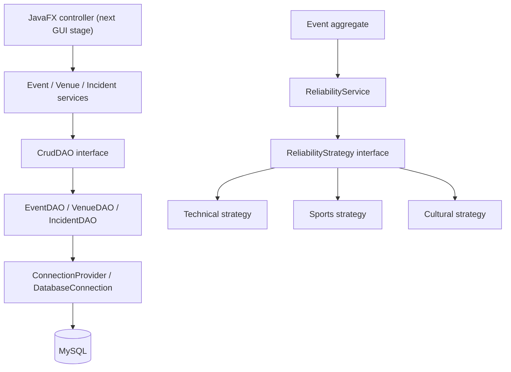
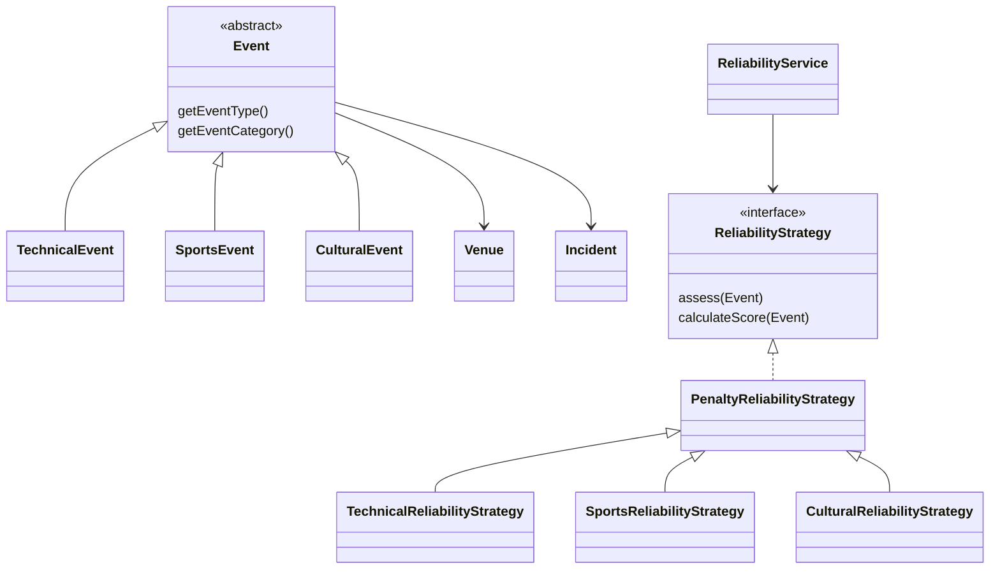
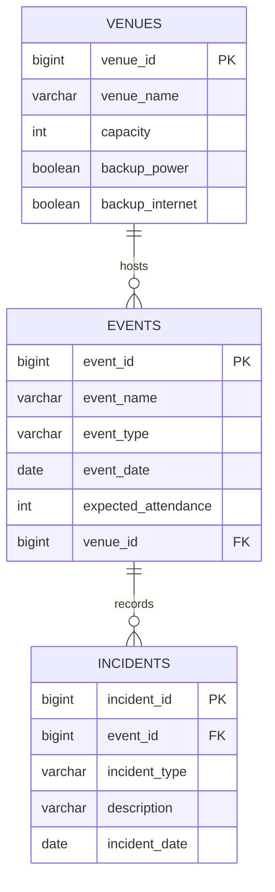

# Stage 2 — Review 2 / Advanced OOP

The core now supports event, venue and incident CRUD over JDBC and explains a
category-specific reliability score. The JavaFX interface remains the foundation
preview; no CRUD forms or simulation were added in this stage.

## Review demonstration

```powershell
mvn test
mvn compile exec:java "-Dexec.mainClass=com.eventproof.demo.Stage2Demo"
```

The demo uses only in-memory fixtures. It creates a list of abstract Event
references holding three different subclasses and passes each to the same
ReliabilityService. Tech Fest scores 70/MEDIUM: 100 minus 5 for 90% attendance,
20 for missing backup internet and 5 for one recorded incident. Sports Meet
scores 100/LOW; Cultural Fest scores 70/MEDIUM.

## OOP evidence for the viva

| Concept | Concrete implementation |
| --- | --- |
| Encapsulation | Private final model fields; validated constructors and defensive incident lists |
| Abstraction | Event cannot be instantiated; subclasses implement category and event type |
| Inheritance | TechnicalEvent, SportsEvent and CulturalEvent extend Event |
| Overriding | Each subclass overrides getEventType and getEventCategory |
| Polymorphism | Stage2Demo iterates List<Event>; DAO hydrates the correct concrete subtype |
| Interfaces | ReliabilityStrategy, CrudDAO<T>, ConnectionProvider |
| Strategy pattern | ReliabilityService selects an interchangeable strategy by EventType |
| Composition | Event contains Venue and an immutable List<Incident> |
| Exception handling | Invalid input exceptions, RecordNotFoundException, wrapped DatabaseException |
| Java libraries | LocalDate, collections, JDBC, try-with-resources, JavaFX, AtlantaFX, Ikonli |

Model invariants are enforced at construction, so every service receives valid
objects. Immutable objects are edited by constructing a replacement with the same
ID. ID zero means unsaved; DAO inserts return a new object with the generated ID.
Services accept CrudDAO interfaces, and DAOs accept a ConnectionProvider, enabling
testing without a GUI or database connection.

## Architecture



ReliabilityService is pure core logic: it does not fetch data or open database
connections. A future controller will load an Event through EventService and pass
that complete aggregate to ReliabilityService. Controllers will handle user-facing
exceptions and perform JDBC work off the JavaFX application thread.



## Reliability rules

These are transparent educational heuristics, not statistical failure
probabilities. Rules are defined in PenaltyReliabilityStrategy and the three
category strategy constructors.

Start at **100**. Subtract the following penalties and clamp the final score to
0–100:

| Factor | Technical | Sports | Cultural |
| --- | ---: | ---: | ---: |
| Expected attendance below 90% of venue capacity | 0 | 0 | 0 |
| Attendance at least 90%, up to and including capacity | 5 | 5 | 5 |
| Attendance above capacity | 25 | 25 | 25 |
| Missing backup power | 20 | 10 | 20 |
| Missing backup internet | 20 | 0 | 5 |
| Each recorded incident | 5 | 5 | 5 |

Attendance brackets are mutually exclusive. Incident penalties are capped at
30. Every incident in this event's history counts equally in Stage 2, regardless
of type; there is no severity, resolution status or venue-wide history yet.
Sports does not depend on internet in this initial rule set. All categories
assume power-dependent operations.

Risk boundaries: **LOW = 80–100**, **MEDIUM = 60–79**, **HIGH = 0–59**.
ReliabilityAssessment contains the score, risk and four ScoreFactor explanations.
Large attendance values use long arithmetic to prevent overflow.

Zero attendance is valid for a draft event. Over-capacity attendance is allowed
so the calculator can flag its risk. Past dates are valid for historical events.
Dates and venue assignment are required. Names are trimmed and limited to 120
Unicode code points; incident descriptions are limited to 2000.

## Database design



Schema: [schema.sql](../src/main/resources/com/eventproof/database/schema.sql).
CHECK constraints require MySQL 8.0.16+; see the
[official MySQL documentation](https://dev.mysql.com/doc/refman/8.0/en/create-table-check-constraints.html).
Discriminator columns use case-sensitive ASCII collations so stored categories
match Java enums exactly. There are no users, scores, notifications or extra tables.

- Venue deletion is restricted while events reference it.
- Event deletion cascades to its incidents.
- Incident deletion leaves the event and venue intact.
- Dates are stored as SQL DATE and mapped to LocalDate.
- EventDAO restores concrete event subtypes and their venue/incident history.
- Listing events uses two queries, not one incident query per event.
- DAO operations use repeatable-read transactions for consistent aggregate reads.
- add requires ID zero; update requires an existing positive ID.
- update never writes an Event's incident list; use IncidentService separately
  and reload the Event to assess the newest history.
- delete returns false at the DAO level for missing rows; services translate that
  into RecordNotFoundException. Missing updates also raise RecordNotFoundException.
- All user data is bound through PreparedStatement parameters.
- SQLException causes are retained in DatabaseException; its public message
  describes the operation without copying raw database diagnostics.

## MySQL verification

Create a development database in Workbench and set DB_URL, DB_USER and DB_PASSWORD
in the terminal, as shown in the README. Then:

```powershell
mvn compile exec:java "-Dexec.mainClass=com.eventproof.database.DatabaseConnectionCheck"
mvn exec:java "-Dexec.mainClass=com.eventproof.database.DatabaseSchemaSetup"
$env:EVENTPROOF_DB_TESTS = 'true'
mvn test "-Dtest=MySqlCrudIntegrationTest"
Remove-Item Env:EVENTPROOF_DB_TESTS
```

Setup is explicit, creates only missing tables and does not migrate existing
definitions. MySQL DDL commits implicitly, so this is not an atomic migration
system. If setup stops partway, fix the underlying error and rerun; never drop
tables containing useful data to troubleshoot.

The live test adds a unique venue, all three event types and incidents. It checks
retrieval, edits, no-op updates, generated IDs, subtype restoration, score
calculation, foreign-key protection and cascade deletion. Finally it removes only
its own test rows. Interrupted tests may leave uniquely named test rows.

Normal tests need no MySQL credentials. They check model validation, defensive
copies, event type preservation, attendance/risk boundaries, category weights,
incident caps, custom strategy injection, invalid inputs, SQL parameter binding,
resource cleanup, commits, rollback and missing records.

## Next stage

Build the Venue, Event and Incident CRUD screens using these services. Then bind
the reliability screen and dashboard to actual Event aggregates, followed by
failure simulation. Persisted score tables and additional frameworks are
unnecessary.
